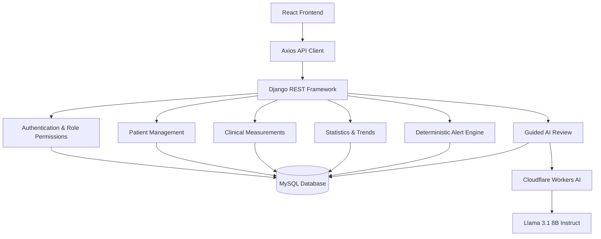
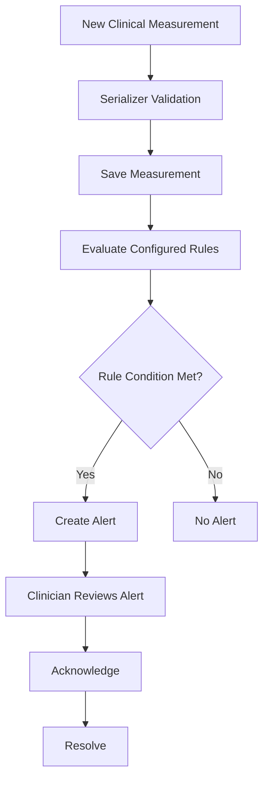

# Clinexa — Clinical Decision Support Platform

<p align="center">
  <strong>A clinician-facing workspace for patient monitoring, clinical insights, deterministic alerts, and guided AI-assisted review.</strong>
</p>

<p align="center">
  
  
  
  
  
  
</p>

---

## Overview

**Clinexa** is a full-stack Clinical Decision Support Platform prototype designed to help clinicians review patient information, monitor clinical measurements, identify readings that meet configured alert rules, explore historical trends, and use a guided AI-assisted review workflow.

The platform combines structured patient records, deterministic backend alerts, clinical statistics, interactive visualizations, and controlled AI-assisted review in one workspace.

> **Important:** Clinexa is an educational and portfolio-oriented prototype, not an autonomous diagnostic, prescribing, or treatment system. It uses synthetic patient data. AI-generated content is assistive only and requires clinician review. Prototype alert thresholds are not clinical guidelines.

## Key Features

| Feature | Description | Status |
|---|---|---|
| Authentication | Registration, login and JWT access/refresh flow | Implemented |
| Role-Based Access | DOCTOR and ADMIN roles with backend permission checks | Implemented |
| Patient Management | Patient records and management APIs | Integrated |
| Clinical Measurements | Five measurement categories with backend validation | Implemented |
| Clinical Statistics | Measurement counts and aggregate statistics | Integrated |
| Clinical Trends | Historical measurements and interactive charts | Integrated |
| Rule-Based Alerts | Backend rules generate alerts from submitted measurements | Implemented |
| Dashboard | Overview populated from backend APIs | Integrated and tested |
| Clinical Data | Patient measurements, filters, latest readings and trends | Integrated |
| Alert Center | Alert filtering, acknowledgement and resolution | Integrated and tested |
| AI Review | Predefined patient-specific review and follow-up options | Implemented; final workflow verification remains |
| Synthetic Dataset | Larger longitudinal dataset for demonstration | Planned |

## Technology Stack

### Frontend

| Technology | Purpose |
|---|---|
| React | Component-based user interface |
| JavaScript | Frontend application logic |
| Vite | Development server and build tooling |
| Tailwind CSS | Styling and responsive layouts |
| React Router | Application navigation and protected routes |
| Axios | Backend API communication |
| Recharts | Clinical data visualization |
| Lucide React | Interface icons |
| React Markdown | Rendering formatted AI responses |

### Backend

| Technology | Purpose |
|---|---|
| Python | Backend programming language |
| Django 5.2 | Backend framework |
| Django REST Framework | REST API development |
| MySQL | Relational database configured in Django settings |
| SimpleJWT | JWT authentication |
| django-cors-headers | Cross-origin request configuration |

### AI Integration

| Technology | Purpose |
|---|---|
| Cloudflare Workers AI | AI inference platform |
| Meta Llama 3.1 8B Instruct | Guided AI-assisted review |

## System Architecture

Clinexa follows a frontend-backend architecture. The React application communicates with Django REST APIs. Django handles authentication, authorization, validation, database operations, clinical statistics, deterministic alert generation, and AI review orchestration.



### Backend Applications

| Django App | Responsibility |
|---|---|
| `users` | Authentication, user management and roles |
| `patients` | Patient records and patient APIs |
| `clinical` | Clinical measurements, validation, statistics and trends |
| `alerts` | Alert records, deterministic rules and alert actions |
| `ai_assistant` | Guided AI review, conversations and messages |

## Clinical Measurements

Clinexa supports five measurement categories:

- Heart Rate (BPM)
- Blood Glucose (mg/dL)
- Blood Pressure (mmHg)
- SpO₂ (%)
- Temperature (°C)

Blood pressure is represented using separate systolic and diastolic values. Other supported measurements use a scalar value where applicable.

## Deterministic Alert Engine

When a clinical measurement is created, the backend validates and saves it, then evaluates the configured rules. If a rule condition is met, an alert is generated and made available through the Alerts API.

| Measurement | Configured prototype condition | Severity |
|---|---|---|
| Heart Rate | Below 50 or above 120 BPM | MEDIUM |
| Blood Glucose | Below 70 or above 180 mg/dL | MEDIUM |
| Blood Pressure | Systolic ≥ 140 or diastolic ≥ 90 mmHg | HIGH |
| SpO₂ | Below 92% | HIGH |
| Temperature | Below 36°C or above 38°C | MEDIUM |



These are prototype rule configurations for demonstration and testing. They are not clinical guidelines or treatment recommendations.

## Guided AI Review

Clinexa includes a controlled AI-assisted review workflow. It is designed around predefined clinical-review options and predefined follow-up choices rather than unrestricted, open-ended medical questions.

The workflow uses patient-specific information available to the application and stores review conversations and messages.

The initial review interaction and a predefined follow-up interaction have been tested. Conversation history and end-review behaviour remain part of final verification.

**AI safety:** Generated content is assistive only. Clinicians remain responsible for reviewing information and making decisions. Clinexa does not independently diagnose, prescribe, or determine treatment.

## API Overview

The backend exposes REST APIs for authentication, patient management, clinical data, alerts, user management and guided AI review.

| Endpoint | Method | Purpose |
|---|---|---|
| `/api/auth/register/` | POST | Register a user |
| `/api/auth/token/` | POST | Obtain JWT tokens |
| `/api/auth/token/refresh/` | POST | Refresh an access token |
| `/api/patients/` | GET, POST | List and create patient records |
| `/api/clinical/` | GET, POST | Retrieve and create clinical measurements |
| `/api/clinical/statistics/` | GET | Retrieve clinical statistics |
| `/api/clinical/trends/` | GET | Retrieve measurement trends |
| `/api/clinical/latest/` | GET | Retrieve latest measurements |
| `/api/clinical/recent/` | GET | Retrieve recent measurements |
| `/api/alerts/` | GET | Retrieve alerts |
| `/api/alerts/active/` | GET | Retrieve active alerts |
| `/api/alerts/statistics/` | GET | Retrieve alert statistics |
| `/api/alerts/{id}/acknowledge/` | PATCH | Acknowledge an alert |
| `/api/alerts/{id}/resolve/` | PATCH | Resolve an alert |
| `/api/ai-assistant/review/` | POST | Start or continue a guided AI review |
| `/api/ai-assistant/end/` | POST | End an AI conversation |
| `/api/ai-assistant/history/` | GET | Retrieve completed review history |

Protected endpoints require valid authentication and appropriate backend permissions. See [`docs/database-and-api.md`](docs/database-and-api.md) for additional API and data-model documentation.

## Getting Started

### Prerequisites

Install the following:

- Python 3.x
- Node.js and npm
- MySQL Server
- Git
- MySQL Workbench (optional)

### 1. Clone the Repository

```bash
git clone <YOUR_GITHUB_REPOSITORY_URL>
cd Clinexa
```

Replace the placeholder with the actual repository URL after publishing the cleaned project.

### 2. Backend Setup

Open a terminal and navigate to the backend:

```bash
cd backend
```

Create a virtual environment:

```bash
python -m venv venv
```

Activate it on Windows:

```bash
venv\Scripts\activate
```

Install the backend packages used by the project:

```bash
pip install django==5.2 djangorestframework django-cors-headers mysqlclient djangorestframework-simplejwt
```

Configure the MySQL database and required Django settings using local environment variables. Do not commit secret keys, database passwords, or AI credentials.

Apply migrations:

```bash
python manage.py migrate
```

Create an administrator account:

```bash
python manage.py createsuperuser
```

Start the backend development server:

```bash
python manage.py runserver
```

The default local development address is:

```text
http://127.0.0.1:8000/
```

### 3. Frontend Setup

Open a second terminal and navigate to the frontend directory from the repository root:

```bash
cd frontend
```

Install dependencies:

```bash
npm install
```

Start the Vite development server:

```bash
npm run dev
```

Open the local URL printed by Vite in the terminal.

### Configuration Notes

- Configure the database name, username, password, host and port for your local MySQL instance.
- Configure Django's secret key and other sensitive settings through environment variables before sharing or deploying the project.
- Configure the frontend API base URL to point to the backend server.
- Configure Cloudflare Workers AI credentials and the required model/service settings before using AI-assisted features.
- Keep `.env` files and credentials out of version control.
- The supplied Django settings configure MySQL. Verify your own active local configuration before running migrations.

**Dependency note:** The uploaded project archive did not contain a backend `requirements.txt`. The install command above lists the core packages identified for this project; create and maintain a pinned requirements file as part of release preparation.

## Project Structure

```text
Clinexa/
├── frontend/
│   ├── src/
│   │   ├── components/
│   │   ├── pages/
│   │   ├── services/
│   │   └── ...
│   └── package.json
│
├── backend/
│   ├── users/
│   ├── patients/
│   ├── clinical/
│   ├── alerts/
│   ├── ai_assistant/
│   ├── config/
│   └── manage.py
│
├── docs/
│   ├── architecture.md
│   ├── workflows.md
│   ├── database-and-api.md
│   ├── PROJECT_PROGRESS.md
│   └── PORTFOLIO.md
│
└── README.md
```

## UI Design Philosophy

Clinexa uses a premium, dark-first clinical SaaS design language:

- Deep navy and charcoal backgrounds.
- Electric cyan and aqua accents.
- Clear clinical status indicators.
- Prominent measurements and readable typography.
- Interactive charts with contextual information.
- Subtle transitions and responsive layouts.
- Accessibility-conscious focus and reduced-motion behaviour.

The objective is to create a focused clinical workspace where patient information remains the visual centerpiece.

## Security and Responsible AI

Clinexa follows these development principles:

- Synthetic patient data for demonstrations.
- JWT-based authentication.
- Backend role-based permission enforcement.
- Serializer-level measurement validation.
- Deterministic alert generation.
- Controlled AI interaction through predefined options.
- Clinician review of AI-generated content.
- No autonomous diagnosis or prescribing.
- Sensitive credentials must remain outside version control.

Before public release, complete a security review covering Django secrets, database credentials, AI credentials, CORS settings, token configuration, debug settings, `.gitignore`, and repository history. Rotate any credentials that may have been exposed.

## Current Development Status

**Current phase:** Feature verification, documentation alignment, and final integration preparation.

Completed or integrated:

- Frontend and backend foundations.
- Authentication and role-based user structure.
- Patient management APIs and frontend integration.
- Clinical measurement APIs and validation for five measurement categories.
- Statistics, latest readings, recent measurements and trends APIs.
- Deterministic alert generation.
- Dashboard backend integration (tested).
- Clinical Data backend integration.
- Alerts backend integration, including acknowledgement and resolution (tested).
- Guided AI review endpoint and initial/follow-up interaction testing.
- Supporting architecture, workflow, database/API, progress and portfolio documentation drafts.

Remaining:

- Final verification of AI conversation history and end-review behaviour.
- Generate a larger longitudinal synthetic dataset.
- Complete cross-page integration and end-to-end testing.
- Review security configuration and move hardcoded secrets into environment variables.
- Add and verify backend dependency lock/requirements documentation.
- Finalize screenshots, demo flow and portfolio documentation.
- Prepare the cleaned repository for GitHub publication.

See [`docs/PROJECT_PROGRESS.md`](docs/PROJECT_PROGRESS.md) for the detailed progress tracker.

## Documentation

- [Architecture](docs/architecture.md)
- [Workflows](docs/workflows.md)
- [Database and API](docs/database-and-api.md)
- [Project Progress](docs/PROJECT_PROGRESS.md)
- [Portfolio Overview](docs/PORTFOLIO.md)

## Disclaimer

Clinexa is an educational and portfolio-oriented clinical decision-support prototype. It is not a medical device and is not a substitute for professional medical judgement. All patient information used for demonstrations is synthetic.

---

<p align="center">
  <strong>Clinexa — Turning Clinical Data into Meaningful Insights.</strong>
</p>

<p align="center">
  Built with React, Django, MySQL and AI.
</p>
