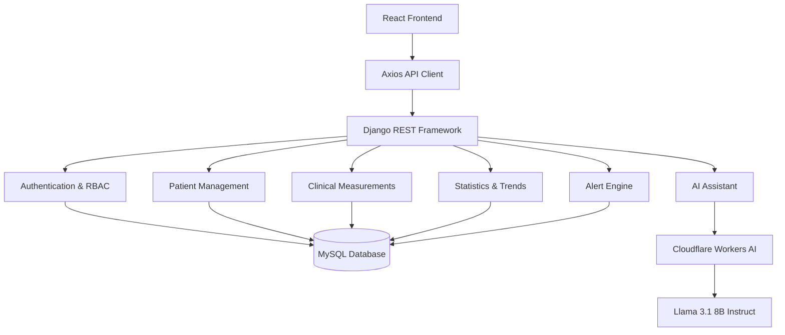
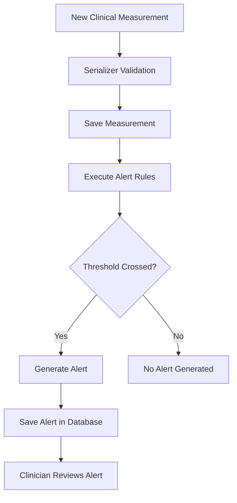

# Clinexa
Clinexa – An AI-assisted Clinical Decision Support Platform
# Clinexa — Clinical Decision Support Platform

<p align="center">
  <strong>A clinical intelligence workspace for patient monitoring, clinical insights, rule-based alerts, and AI-assisted review.</strong>
</p>

<p align="center">
  
  
  
  
  
  
</p>

---

## Overview

**Clinexa** is a full-stack, clinician-facing Clinical Decision Support Platform designed to help healthcare professionals review patient information, monitor clinical measurements, identify abnormal readings, explore historical trends, and receive contextual AI-assisted insights.

The platform combines structured patient data, deterministic rule-based alerts, interactive data visualizations, and a controlled AI review workflow into a unified clinical workspace.

Clinexa aims to make clinical information easier to interpret by presenting relevant measurements, trends, and alerts in a clear and organized interface.

> **Important:** Clinexa is a clinical decision-support prototype, not an autonomous diagnostic or treatment system. It uses synthetic patient data. It does not independently diagnose diseases, prescribe medication, or determine treatment. AI-generated content requires clinician review.

## Key Features

| Feature | Description | Status |
|---|---|---|
| Authentication | Secure registration and login using JWT | Implemented |
| Role-Based Access | Separate Doctor and Admin roles | Implemented |
| Patient Management | Create, retrieve and manage patient records | Implemented |
| Clinical Measurements | Record five types of clinical measurements | Implemented |
| Clinical Statistics | Aggregate measurement statistics | Implemented |
| Clinical Trends | Historical measurement visualization | Implemented |
| Rule-Based Alerts | Automatically identify configured abnormal readings | Implemented |
| Dashboard | Clinical command center and overview | Implemented |
| Clinical Data | Real patient data, filters and interactive trends | Integrated |
| Alert Center | Review and filter clinical alerts | UI complete; API integration pending |
| AI Review | Guided patient-specific AI-assisted review | In development |
| Synthetic Dataset | Generate longitudinal patient histories | Planned |
| Auditability | Traceable clinical-support activity | Foundation implemented; enhancements planned |

## Technology Stack

### Frontend

| Technology | Purpose |
|---|---|
| React | Component-based user interface |
| JavaScript | Frontend application logic |
| Vite | Development server and build tooling |
| Tailwind CSS | Styling and responsive layouts |
| React Router | Application navigation and protected routes |
| Axios | Backend API communication |
| Recharts | Interactive clinical data visualization |
| Lucide React | Interface icons |

### Backend

| Technology | Purpose |
|---|---|
| Python | Backend programming language |
| Django | Backend framework |
| Django REST Framework | REST API development |
| MySQL | Relational database |
| SimpleJWT | JWT authentication |
| Django CORS Headers | Cross-origin communication |

### AI Integration

| Technology | Purpose |
|---|---|
| Cloudflare Workers AI | AI inference platform |
| Meta Llama 3.1 8B Instruct | Contextual AI-assisted review |

## System Architecture

Clinexa follows a frontend-backend architecture in which React communicates with Django REST APIs, while Django manages authentication, business logic, database operations, clinical rules and AI integration.



### Backend Applications

| Django App | Responsibility |
|---|---|
| users | Authentication, user management and roles |
| patients | Patient records and CRUD operations |
| clinical | Clinical measurements, validation, statistics and trends |
| alerts | Alert models, deterministic rules and alert generation |
| ai_assistant | Controlled AI integration and review workflow |

## Clinical Measurements

Clinexa supports five clinical measurement categories:

- Heart Rate (BPM)
- Blood Glucose (mg/dL)
- Blood Pressure (mmHg)
- SpO₂ (%)
- Body Temperature (°C)

Blood pressure is stored using separate systolic and diastolic values, while other measurements use scalar values.

## Rule-Based Alert System

Clinexa uses a deterministic rule engine to identify measurements that cross configured prototype thresholds.

| Measurement | Configured Threshold | Severity |
|---|---|---|
| Heart Rate | Below 50 or above 120 BPM | Medium |
| Blood Glucose | Below 70 or above 180 mg/dL | Medium |
| Blood Pressure | Systolic ≥ 140 or diastolic ≥ 90 mmHg | High |
| SpO₂ | Below 92% | High |
| Temperature | Below 36°C or above 38°C | Medium |

### How It Works



These thresholds are configurable prototype decision-support rules, not standalone clinical guidelines or treatment recommendations.

## Guided AI Review

Clinexa incorporates an AI-assisted clinical review system designed around predefined interactions rather than an unrestricted medical chatbot.

### Planned Interaction Flow

1. Doctor selects a patient.
2. Doctor opens the AI Review section.
3. Clinexa presents predefined review categories.
4. Doctor selects a review category.
5. Backend retrieves relevant patient measurements, statistics, trends and alerts.
6. Context is supplied to the AI model.
7. AI generates a contextual review.
8. Clinexa presents predefined follow-up options.
9. Doctor reviews and interprets the generated content.

### Initial Review Categories

- Vital Trends
- Abnormal Readings
- Recent Measurements
- Alert Summary

**AI Safety:** AI-generated responses are assistive only. Clinician review remains necessary. The system does not independently diagnose, prescribe or determine treatment.

## API Endpoints

The backend exposes REST APIs for authentication, patient management, clinical data and alerts.

| Endpoint | Purpose |
|---|---|
| `POST /api/auth/register/` | User registration |
| `POST /api/auth/token/` | JWT login |
| `POST /api/auth/token/refresh/` | Refresh access token |
| `/api/patients/` | Patient CRUD |
| `/api/clinical/` | Clinical measurement CRUD |
| `/api/clinical/statistics/` | Aggregate statistics |
| `/api/clinical/trends/` | Historical trends |
| `/api/clinical/latest/` | Latest readings |
| `/api/alerts/` | Clinical alert management |
| `/api/users/` | Admin user management |

Protected endpoints require appropriate authentication and permissions.

## Getting Started

### Prerequisites

Install the following before running Clinexa:

- Python 3.x
- Node.js and npm
- MySQL Server
- MySQL Workbench (optional)
- Git

### 1. Clone the Repository

```bash
git clone <https://github.com/Tiyasha16/Clinexa.git>
cd Clinexa
```

### 2. Backend Setup

Navigate to the Django backend directory:

```bash
cd backend
```

Create and activate a virtual environment:

```bash
python -m venv venv
```

Windows:

```bash
venv\Scripts\activate
```

Install the required dependencies:

```bash
pip install django djangorestframework django-cors-headers mysqlclient djangorestframework-simplejwt
```

Configure the MySQL database and Django settings using your local development configuration.

Apply migrations:

```bash
python manage.py migrate
```

Create an administrator account:

```bash
python manage.py createsuperuser
```

Start the Django development server:

```bash
python manage.py runserver
```

Backend server:

`http://127.0.0.1:8000/`

### 3. Frontend Setup

Open another terminal and navigate to the frontend directory:

```bash
cd frontend
```

Install dependencies:

```bash
npm install
```

Start the Vite development server:

```bash
npm run dev
```

Open the local development URL displayed by Vite.

### Configuration Notes

- Configure database credentials and Django secrets locally; never commit them.
- Configure the frontend API base URL to match the backend.
- Configure Cloudflare Workers AI credentials and endpoint before running AI-assisted features.
- Keep sensitive credentials in environment variables.

## Project Structure

The following is the intended high-level organization; adjust directory names to match the actual repository.

```text
Clinexa/
│
├── frontend/
│   ├── src/
│   │   ├── components/
│   │   ├── pages/
│   │   ├── services/
│   │   └── ...
│   └── package.json
│
├── backend/
│   ├── users/
│   ├── patients/
│   ├── clinical/
│   ├── alerts/
│   ├── ai_assistant/
│   └── manage.py
│
├── docs/
│   ├── architecture.md
│   ├── workflows.md
│   ├── database-and-api.md
│   ├── PROJECT_PROGRESS.md
│   └── PORTFOLIO.md
│
└── README.md
```

## UI Design Philosophy

Clinexa uses a premium, dark-first clinical SaaS design language.

- Deep navy and charcoal backgrounds.
- Electric cyan and aqua intelligence accents.
- Green, amber and red clinical status indicators.
- Prominent clinical measurements and clean typography.
- Interactive charts with contextual information.
- Floating navigation and subtle transitions.
- Responsive layouts and accessibility-conscious interactions.

The objective is to create a focused clinical workspace where patient data remains the visual centerpiece.

## Security and Responsible AI

Clinexa follows these development principles:

- Synthetic patient data only.
- JWT-protected API access.
- Role-based authorization.
- Input validation for clinical measurements.
- Deterministic alert generation.
- Controlled AI interaction.
- Clinician review of AI-generated content.
- No autonomous diagnosis or prescribing.
- Sensitive credentials must remain outside version control.

## Current Development Status

**Current checkpoint: Alerts frontend API integration.**

Completed:
- Frontend and backend foundations.
- Authentication and role-based access.
- Patient management APIs.
- Clinical measurement APIs and validation.
- Statistics, latest readings and trends.
- Rule-based alert engine for all five metrics.
- Dashboard and Patients UI.
- Backend-integrated Clinical Data page.
- Initial Alerts and AI Review interfaces.
- Cloudflare Workers AI endpoint testing.

In progress / remaining:
- Integrate Alerts page with real backend data.
- Complete alert actions where supported.
- Replace remaining static Dashboard values.
- Implement the complete guided AI Review workflow.
- Generate a larger synthetic dataset.
- Complete cross-page and end-to-end testing.
- Improve audit logging.
- Complete security and deployment configuration.
- Prepare final screenshots and portfolio documentation.

See [`docs/PROJECT_PROGRESS.md`](docs/PROJECT_PROGRESS.md) for the detailed development tracker.

## Future Enhancements

- Longitudinal synthetic patient dataset.
- More comprehensive clinical trend analysis.
- Complete guided AI review and contextual follow-ups.
- Improved audit trails.
- Comprehensive API and integration testing.
- Production deployment and documentation.

## Portfolio Significance

Clinexa demonstrates the practical application of full-stack development, relational database design, REST API engineering, authentication, clinical data visualization, deterministic rule processing and AI integration.

The project highlights the distinction between traditional rule-based clinical alerts and AI-assisted contextual review, with an emphasis on responsible AI boundaries and clinician oversight.

## Disclaimer

Clinexa is an educational and portfolio-oriented clinical decision-support prototype. It is not a medical device or a substitute for professional medical judgment. All patient information used in the project is synthetic.

---

<p align="center">
  **Clinexa — Turning Clinical Data into Meaningful Insights.**
</p>

<p align="center">
  Built with React, Django, MySQL and AI.
</p>
